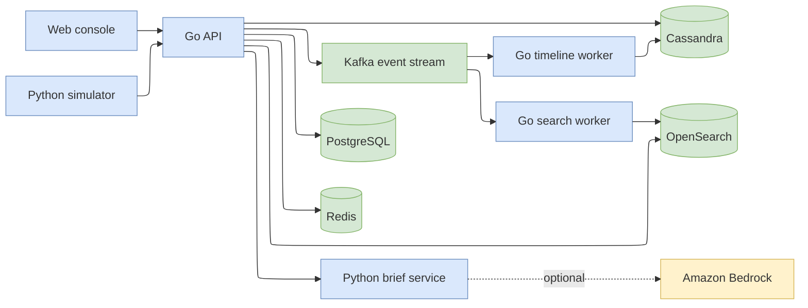
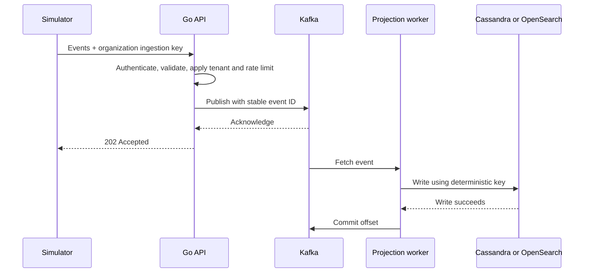

# SignalDesk

**Follow the signal. See the story.**

SignalDesk brings identity, endpoint and cloud activity into one security investigation workspace. Follow an entity across domains, inspect the evidence, and save the context for your team.

- **Unified investigations:** searchable events, a chronological entity timeline, and explainable cross-domain indicators.
- **Role-specific workspaces:** configurable analyst widgets, a manager overview, and shared investigation records.
- **Tenant-scoped access:** session authentication, role-aware APIs, and organization-specific ingestion keys.
- **Event-driven processing:** Kafka feeds independent Cassandra and OpenSearch projections, with explicit offset commits, retry backoff, dead-letter routing, and replay-safe writes.
- **Evidence-linked briefs:** deterministic summaries or optional Amazon Bedrock generation, with event references validated against the supplied evidence.
- **Cloud deployment:** Docker Compose, Kubernetes manifests, EKS configuration, JSON logs, and Prometheus-format metrics.

## Stack

| Layer | Technologies |
| --- | --- |
| Application | Go, Python, HTML, CSS, JavaScript |
| Streaming | Apache Kafka |
| Data | Cassandra, OpenSearch, PostgreSQL, Redis |
| Deployment | Docker Compose, Kubernetes, AWS EKS |
| Optional AI | Amazon Bedrock |

## Run locally

Install **Docker with Docker Compose v2**. Allocate approximately **8 GB of Docker memory** for the complete stack. The images install the Go and Python dependencies; no Node.js installation is needed.

```sh
cp .env.example .env
docker compose up --build -d
docker compose --profile demo run --rm simulator
```

Open **[localhost:8080](http://localhost:8080)**. Sign in using `DEMO_PASSWORD` from `.env`:

| Organization | Analyst | Manager |
| --- | --- | --- |
| Acme Security | `analyst@acme.local` | `manager@acme.local` |
| Northstar Labs | `analyst@northstar.local` | `manager@northstar.local` |

In the Acme analyst workspace, open **Event explorer**, search for **`alex.morgan`**, and open the entity timeline. The simulator connects an unusual login, elevated cloud permissions, a suspicious endpoint process, and sensitive object access. Generate an evidence brief or save the investigation, then switch to the manager account for the aggregate view.

For AI briefs, set `BEDROCK_MODEL_ID` and AWS credentials in `.env`, then recreate the brief service:

```sh
docker compose up -d --force-recreate brief
```

For native development, install **Go 1.24+** and **Python 3.12+**. Go dependencies are declared in `go.mod` (`pgx`, `gocql`, `kafka-go`, `go-redis`, `uuid`, `x/crypto`). Python dependencies are FastAPI, Uvicorn and Boto3:

```sh
go mod download
python -m pip install -r services/brief/requirements.txt
```

The simulator uses only Python's standard library. Kubernetes/AWS setup uses `kubectl`, AWS CLI and `eksctl`; see [deployment instructions](docs/operations.md).

## System design





[HLD and LLD](docs/design.md) · [API contracts](docs/api.md) · [Operations and AWS deployment](docs/operations.md) · [Editable architecture diagram](docs/architecture.drawio)
