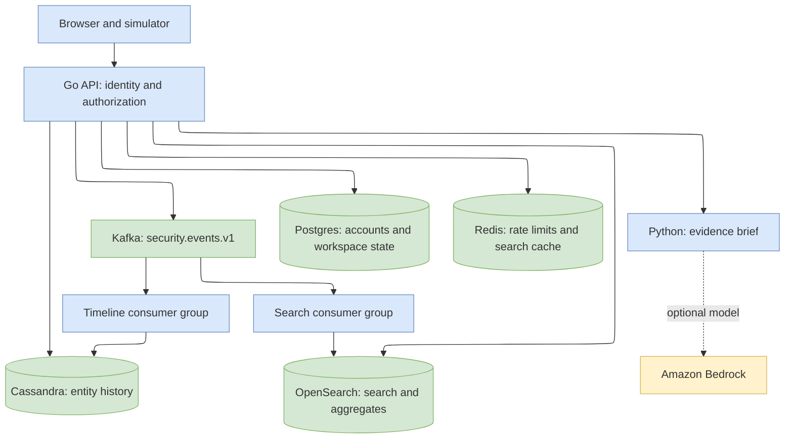
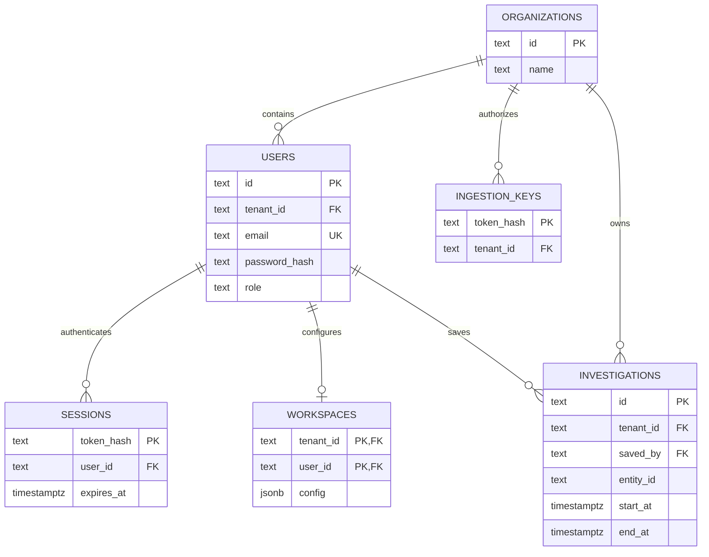

# SignalDesk design

## Goals

Connect identity, endpoint and cloud evidence in an organization-scoped workspace. Support a clear investigation flow and make event processing independently scalable and recoverable.

## High-level design

Three application components share one repository:

| Component | Responsibilities |
| --- | --- |
| Go API | Console assets, cookie sessions, ingestion, search/timeline queries, workspaces, investigations, brief orchestration |
| Go workers | Separate `timeline` and `search` Kafka consumers; the same binary runs each projection |
| Python brief service | Deterministic or Bedrock summaries of evidence supplied by the API |

The Python simulator is a command-line ingestion client. Docker Compose starts the complete system. Kubernetes deploys the same application images; EKS adds the AWS cluster and EBS storage configuration.



## Low-level design

### Request lifecycle

Go's standard `net/http` router handles method-specific routes. Middleware adds a request ID, security headers, request timeout, metrics and structured logs. Authenticated handlers receive an `auth.Identity` in their context. SQL calls use parameters and tenant predicates. Browser mutations enforce same-origin checks; session cookies are HttpOnly and SameSite=Strict.

Opaque 256-bit session tokens expire after 12 hours. Postgres stores token hashes and bcrypt password hashes. Ingestion uses separate hashed API keys associated with an organization. Tenants are assigned by the server; ingestion rejects caller-supplied tenant or ingestion timestamps.

| Capability | Analyst | Manager | Ingestion key |
| --- | --- | --- | --- |
| Search raw events / timeline / brief | Yes | No | No |
| Read aggregate overview | Yes | Yes | No |
| Read personal default workspace | Yes | Yes | No |
| Configure own workspace | Yes | No | No |
| Read shared investigation metadata | Yes | Yes | No |
| Save/delete organization investigations | Yes | No | No |
| Publish events | No | No | Own organization |

### Event contract

Events use schema version 1 and a canonical UUID. `entity_id` is the normalized identity connecting the domains. Events contain an occurrence timestamp, domain, action, severity, actor, asset, message and bounded string metadata. Go assigns `tenant_id` and a millisecond-resolution `ingested_at` before publishing.

Each logical event has an immutable ID and occurrence timestamp. Clients preserve both when retrying a publication. Kafka keys are `tenant_id:entity_id`, preserving partition order for that entity. Processing order represents arrival order; occurrence timestamps drive timeline presentation.

### Data model



| Store | Keys and access pattern |
| --- | --- |
| Cassandra | Partition `(tenant_id, entity_id, event_day)`; cluster by `occurred_at DESC, event_id ASC`. Read at most seven UTC day partitions and 200 events. TTL ends 30 days after ingestion, including on replay. |
| OpenSearch | Index `signaldesk-events-v1`; document ID `tenant_id:event_id`. Keyword filters, text search, explicit tenant predicate, strict mapping. Search time range is bounded to the last 30 days; pagination is limited to the first 1,000 hits. |
| Postgres | Tenant-owned users, ingestion keys, workspaces and investigations. Composite foreign keys prevent cross-tenant ownership. Sessions link to an authenticated user. |
| Redis | Search key is tenant + hash of normalized filters; cache TTL 10 seconds. Atomic Lua increments enforce event budgets and login attempt limits. |

The two projections become visible independently. The overview reports the latest ingestion timestamp visible in the search index. Search responses report snapshot time and cache use. These describe visible data; Kafka consumer lag is inspected separately.

### Worker lifecycle

1. Fetch an event from the projection's consumer group.
2. Decode and validate the envelope. Route malformed records to `security.events.dead.v1`.
3. Write the event to the projection. On transient write failure, retry with exponential backoff capped at eight seconds.
4. Commit the Kafka offset synchronously after the write or dead-letter publication succeeds.
5. On shutdown, cancel pending work and leave unfinished offsets uncommitted.

Cassandra writes reuse the complete primary key; OpenSearch writes reuse the document ID. Replaying an existing message overwrites its projection record. Each process handles fetched messages sequentially, so a later offset cannot overtake a failed write within that process. A failed commit terminates the worker so its consumer group can resume from committed state.

The event and dead-letter topics default to six partitions. `signaldesk-timeline-v1` and `signaldesk-search-v1` scale independently up to partition count. The supplied dependency deployments use one database node and one Kafka broker; application worker replication is configured separately.

### Workspace contract

The version 1 registry contains four widget types: `recent-events`, `severity-breakdown`, `domain-breakdown` and `entity-timeline`. Each definition declares roles and accepted configuration fields. Workspace saves validate version, unique instance IDs, field names, role authorization and an eight-widget limit.

Widgets call the same documented APIs used by the rest of the console. Adding a widget requires a registry definition and a corresponding console renderer; arbitrary code execution is outside the widget contract.

### Findings and briefs

Four known actions generate explainable findings. If suspicious activity spans all three domains for the queried entity, the timeline adds a cross-domain indicator with supporting event IDs. This associates evidence; it does not establish causality.

Brief requests query Cassandra through the authenticated API, select at most 100 events, and send that evidence to the internal Python service. The service checks its shared credential and requires one tenant and entity per request. A configured Bedrock model receives event text as untrusted data and returns structured claims. Both services validate cited IDs against supplied events. On service failure or invalid model output, the API produces a deterministic brief.

### Availability and operations

- Search unavailability does not remove working timeline routes from Kubernetes readiness. `/readyz` checks Postgres and Cassandra.
- Cache read failures use uncached search. Rate-limit failures reject new ingestion/login attempts.
- API and worker shutdowns have bounded drain time. Dependencies have connection and request timeouts.
- JSON logs include request IDs and durations. Prometheus text metrics cover requests, errors, total request duration, ingested/processed events, retries, dead letters and last successful processing time.
- The API image embeds console assets and database migrations. Initialization is an explicit command and a Kubernetes Job.

## Source layout

```text
cmd/signaldesk/       api, worker and init entry point
internal/api/         HTTP routes, middleware, widget registry and briefs
internal/auth/        identity, password and token helpers
internal/bootstrap/   schema initialization and optional demo accounts
internal/config/      environment settings
internal/model/       event/filter validation and findings
internal/store/       Postgres, Cassandra, OpenSearch and Redis adapters
internal/stream/      Kafka publishing, consumer loop and dead letters
internal/telemetry/   service metrics
migrations/          embedded SQL and CQL
web/                 console HTML, JavaScript and CSS
services/brief/      Python summary service
tools/               synthetic event generator
deploy/              Compose settings, Kubernetes resources and AWS cluster
docs/                design, API and operations
```
